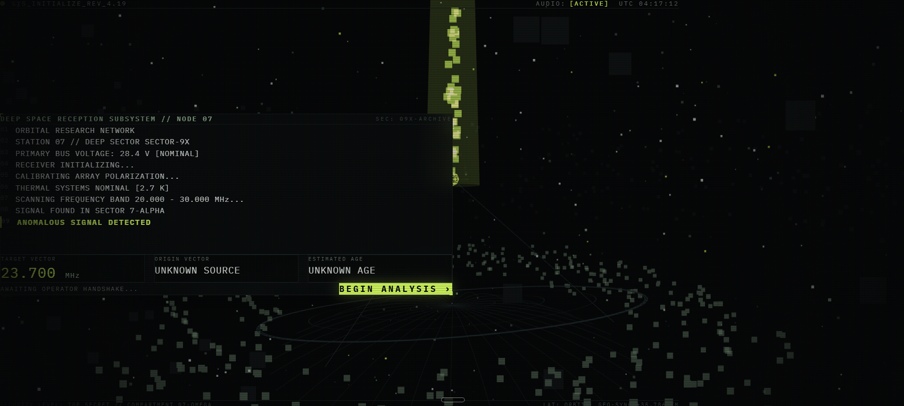
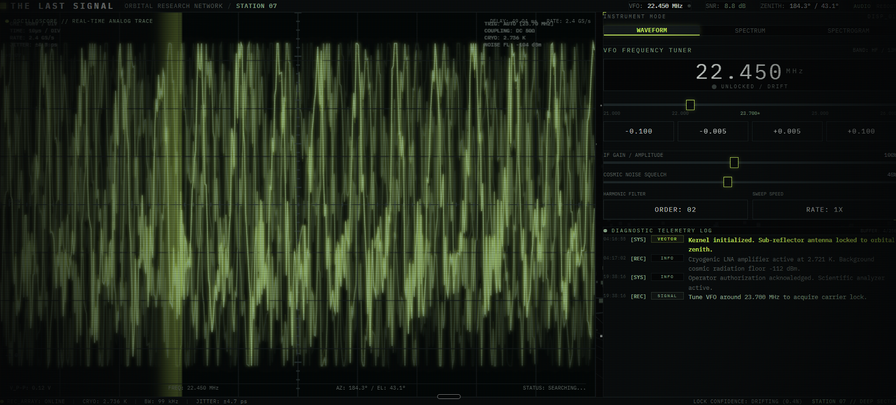

<p align="center">
  
</p>

<h1 align="center">THE LAST SIGNAL</h1>

<p align="center">
  <strong>An unknown transmission. Three stations. One impossible origin.</strong>
</p>

<p align="center">
  A cinematic, browser-based investigation that puts you at the console of an orbital signal-analysis laboratory —<br>
  from the first anomalous carrier at <code>23.700 MHz</code> to a triangulated source 14.7 light-years away, and a truth nobody expected.
</p>

<p align="center">
  
  
  
  
  
  
</p>

---

## Table of Contents

- [Overview](#overview)
- [The Experience](#the-experience)
- [Key Features](#key-features)
- [Visual Showcase](#visual-showcase)
- [Technical Architecture](#technical-architecture)
- [Project Structure](#project-structure)
- [How It Works](#how-it-works)
- [Triangulation System](#triangulation-system)
- [Design Philosophy](#design-philosophy)
- [Running Locally](#running-locally)
- [Production Build](#production-build)
- [Development Workflow](#development-workflow)
- [Hackathon Context](#hackathon-context)
- [Future Improvements](#future-improvements)
- [Credits / Acknowledgements](#credits--acknowledgements)
- [License](#license)

---

## Overview

**THE LAST SIGNAL** is an interactive deep-space signal investigation. You are the operator of **Station 07**, a deep-sector receiver of the fictional *Orbital Research Network*. A cold boot surfaces a narrowband anomaly at `23.700 MHz` — unknown source, unknown age — and hands you the instruments to work it: a live VFO tuner, an oscilloscope, a spectrum analyzer, a scrolling spectrogram, and a terminal that streams diagnostics as you work.

What follows is a continuous investigation rather than a set of pages: tune the carrier into resonance, survive the lock event, classify the anomaly against rejected hypotheses, isolate the transmission, decode the message, and triangulate its origin across three orbital stations.

**What makes it different from a normal dashboard or website:**

- There is no navbar, no content sections, no marketing surface. The entire screen is one machine.
- Every visual is rendered live — Canvas instruments, a Three.js observatory, synthesized audio — nothing is a screenshot or a chart library.
- The narrative is driven by *signal state*, not by clicks through a menu. Progress happens because you operate the instrument well.
- Information density behaves like real instrumentation: dense micro-typography, telemetry that fluctuates for physical reasons, and status changes that mean something.

---

## The Experience

The investigation flows through one continuous state sequence:

1. **Initial Signal Detection** — A cinematic cold boot streams station diagnostics (`PRIMARY BUS VOLTAGE: 28.4 V`, `THERMAL SYSTEMS NOMINAL [2.7 K]`, `SCANNING FREQUENCY BAND 20.000 – 30.000 MHz…`) until it lands on `ANOMALOUS SIGNAL DETECTED`. The target vector reads `23.700 MHz`, origin `UNKNOWN SOURCE`, age `UNKNOWN AGE`. One control: `BEGIN ANALYSIS`.

2. **Signal Analysis** — The main console comes alive. The VFO starts at `22.450 MHz`, drifting. You tune with coarse (`±0.100 MHz`) and fine (`±0.005 MHz`) steppers, adjusting IF gain, cosmic noise squelch, harmonic filter order and sweep speed while the instruments respond in real time.

3. **Waveform / Spectrogram Visualization** — Three interchangeable instruments — **WAVEFORM**, **SPECTRUM**, **SPECTROGRAM** — each rendering the same live signal from a different physical perspective: analog-style time-domain trace, frequency-magnitude histogram with peak hold, and a scrolling time-vs-frequency waterfall.

4. **Anomaly Investigation** — Hold the carrier near `23.700 MHz` and resonance builds until the screen itself reacts. After the **RESONANCE LOCK** event, the anomaly classification suite runs competing hypotheses — cosmic noise, pulsar flux, orbital satellite, terrestrial reflection — and rejects each one. `ARTIFICIAL EMISSION` is confirmed at 96.2% confidence.

5. **Source Triangulation** — The decoded transmission is handed to a celestial baseline solve linking three receiving stations across the network.

6. **Station Acquisition and Locks** — `STATION 07`, `STATION 12` and `STATION 19` lock in sequence, each reporting coordinates, bearing, elevation, arrival delay and signal strength.

7. **Vector Intersection** — Three bearing vectors converge on a luminous source marker deep in the starfield while the system computes the intersection.

8. **Source Coordinates** — The solution locks:

   ```
   RIGHT ASCENSION   07h 41m 13.7s
   DECLINATION       −23° 41′ 08.2″
   DISTANCE          14.7 LIGHT YEARS
   CONFIDENCE        99.97%
   ```

9. **Final Source Reveal** — Origin analysis runs: `SIGNAL AGE … 14.7 YEARS`, `PROPAGATION … CONFIRMED`, `SOURCE … ACTIVE`. Then the reveal the whole investigation has been building toward — **`SIGNAL ORIGIN: EARTH`** — and a final, near-silent screen: `TRANSMISSION COMPLETE`, `SOURCE: UNKNOWN`, `ORIGIN: EARTH`, `CONNECTION: ACTIVE`, and one slowly pulsing beacon.

---

## Key Features

| Feature | Description |
| --- | --- |
| **Interactive Signal Analysis** | A physically-modeled VFO tuner with fine/coarse steppers, IF gain, noise squelch, harmonic filter order and sweep speed. The carrier responds continuously — approaching `23.700 MHz` raises coherence, lifts the peak, and eventually arms the lock. |
| **Real-time Visualizations** | A single `requestAnimationFrame` loop drives a deterministic signal engine that produces time-domain and frequency-domain buffers every frame. Instruments consume raw `Float32Array` data — no chart libraries. |
| **Waveform / Spectrum / Spectrogram** | An analog-style oscilloscope with grid, trigger sweep and measurement readouts; a spectrum analyzer with peak-hold markers and dBm scaling; a scrolling spectrogram waterfall with a restrained scientific heat palette. |
| **Anomaly Detection & Investigation** | A classification suite with an animated hypothesis-elimination table (`COSMIC NOISE — REJECTED`, `PULSAR FLUX — REJECTED`, `ORBITAL SATELLITE — REJECTED`, `TERRESTRIAL REFLECTION — REJECTED`, `ARTIFICIAL EMISSION — CONFIRMED`). |
| **Multi-Station Triangulation** | Three fictional receiving stations with deterministic telemetry lock in sequence; animated signal paths converge on a computed intersection rendered against a live celestial canvas. |
| **Dynamic Triangulation Progress** | A phase indicator synchronized with the investigation state advances through `STATION ACQUISITION → LOCK 07 → LOCK 12 → LOCK 19 → VECTOR INTERSECTION → SOURCE COORDINATES → SOURCE LOCKED`. |
| **Terminal-style System Logs** | A live diagnostic stream with real timestamps and source tags — `[SYS]`, `[REC]`, `[ARRAY]`, `[DSP]`, `[DECODER]`, `[TRIANGULATION]`, `[CLASSIFIED]` — each entry severity-tagged (`info` / `warn` / `success` / `alert`). |
| **Signal & Event Categorization** | Signal states (drift, lock, isolation) and system events (hypothesis results, burst acquisition, vector solve) are classified and logged distinctly, so the terminal reads like a real ops record. |
| **Sound Design / System Feedback** | A fully synthesized Web Audio engine — mechanical boot hum, dial ticks, rising resonance tone, lock confirmation, isolation collapse, decode chirps, per-station triangulation pings, vector-intersection tone, the Earth reveal chord, and near-silence at the end. Mute is a visible, persistent control. |
| **Earth / Source Reveal** | A staged origin-analysis sequence delivers the twist in telemetry before prose, letting the operator sit with `SIGNAL ORIGIN: EARTH` before the interface dissolves. |
| **Immersive Deep-Space Interface** | A Three.js observatory — rotating dish, focal assembly, starfield, orbital rings, transmission beam — layered behind CRT scanlines and phosphor vignetting, with subtle mouse parallax throughout. |
| **Hidden Details** | A couple of deliberately buried diagnostics reward attentive operators (one lives in the header). No spoilers here. |

<details>
<summary><strong>Instrumentation telemetry reference</strong> (click to expand)</summary>

Values are deterministic and coupled to the signal state rather than randomly generated:

| Readout | Example | Behavior |
| --- | --- | --- |
| VFO frequency | `22.450 MHz` | Operator-controlled, drifts when unlocked |
| Carrier lock | `UNLOCKED / DRIFT` → `SIGNAL LOCKED` | Armed within the lock window around `23.700 MHz` |
| SNR | `8.8 dB` | Rises as noise squelch and resonance improve |
| Noise floor | `−112 dBm` | Baseline cosmic radiation floor |
| Cryogenic LNA temp | `2.721 K` | Fluctuates with receiver load |
| Antenna azimuth / elevation | `184.3° / 43.1°` | Tracks the target vector |
| Sampling rate | `2.4 GS/s` | Instrument constant |
| FFT size | `4096 bins` | Spectrum resolution |
| Clock jitter | `±1.4 ps` | Sub-picosecond stability indicator |
| Propagation delay | `49.02 ms` | Tied to the geometry of the solve |
| Bandwidth | `99 kHz` | Effective analysis window |

</details>

---

## Visual Showcase

### Deep-Space Reception Subsystem — Cold Boot


*Station 07 cold-boot diagnostics stream past beneath a vertical transmission artifact while the array scans the 20–30 MHz band. The sequence terminates on `ANOMALOUS SIGNAL DETECTED` and presents the three unknowns — `23.700 MHz`, `UNKNOWN SOURCE`, `UNKNOWN AGE` — before unlocking the single `BEGIN ANALYSIS` handshake.*

### Scientific Analysis Console — Live Instrumentation



*The main instrument interface: a full-height real-time oscilloscope trace on the left; on the right the VFO frequency tuner (`22.450 MHz`, unlocked/drift), fine-tuning steppers, IF gain and cosmic noise squelch sliders, harmonic filter and sweep speed selectors, and the live diagnostic telemetry log recording every operator action and system response.*

---

## Technical Architecture

| Technology | Role | Where |
| --- | --- | --- |
| **React 19** | UI composition and the investigation state machine | `src/App.tsx`, `src/components/*` |
| **TypeScript** | Strictly-typed signal, telemetry and narrative models | `src/types/signal.ts`, all modules |
| **Vite 8** | Dev server and production bundling (`@vitejs/plugin-react`) | `vite.config.ts` |
| **Tailwind CSS 4** | Instrument styling system (via `@tailwindcss/vite`) | `src/index.css`, component classes |
| **Three.js** | WebGL observatory environment behind the interface | `src/components/ObservatoryBackground.tsx` |
| **Canvas 2D** | All high-frequency instrument rendering | `Waveform`, `Spectrum`, `Spectrogram`, `SourceTriangulation` |
| **Web Audio API** | Fully synthesized sound engine (no audio files) | `src/lib/soundEngine.ts` |
| **vite-plugin-singlefile** | Emits the production build as one self-contained HTML file | `vite.config.ts` |

**Rendering strategy.** A single `requestAnimationFrame` loop in `App.tsx` steps a deterministic signal engine each frame, producing `Float32Array` waveform and spectrum buffers plus a telemetry snapshot. The Canvas instruments draw directly from these buffers at display rate, while the Three.js scene reacts to state flags (anomaly, isolation, resonance lock, triangulation, Earth origin) and live signal strength. React state updates are kept to the telemetry feed and narrative transitions — visualizations never trigger renders on their own.

**Audio strategy.** Every sound — hums, ticks, alarms, pings, chords — is synthesized at runtime from oscillators, noise buffers and filters. The `AudioContext` is resumed on first interaction to comply with browser autoplay policies, and all nodes are short-lived and garbage-collected naturally.

---

## Project Structure

```
THE-LAST-SIGNAL/
├── index.html                     # Shell + document metadata
├── vite.config.ts                 # React + Tailwind + single-file build plugins
├── docs/
│   └── images/                    # README screenshots
├── public/                        # Static assets (favicon, icons)
└── src/
    ├── main.tsx                   # React entry point
    ├── App.tsx                    # Investigation state machine + instrument layout
    ├── index.css                  # Theme tokens, CRT/scanline overlays, animations
    ├── types/
    │   └── signal.ts              # AppState, SignalParameters, SignalTelemetry,
    │                              #   TerminalEntry, TriangulationStation, CelestialCoordinates
    ├── lib/
    │   ├── signalGenerator.ts     # Deterministic SignalEngine (carrier, harmonics,
    │   │                          #   noise, pulse pattern, lock detection)
    │   └── soundEngine.ts         # Web Audio synthesizer + state cue library
    └── components/
        ├── BootSequence.tsx       # Cinematic cold boot + BEGIN ANALYSIS handshake
        ├── ObservatoryBackground.tsx  # Three.js deep-space observatory scene
        ├── SystemHeader.tsx       # Top status bar, VFO/SNR/Zenith readouts, mute
        ├── Waveform.tsx           # Real-time oscilloscope instrument
        ├── Spectrum.tsx           # FFT magnitude analyzer with peak hold
        ├── Spectrogram.tsx        # Scrolling time-vs-frequency waterfall
        ├── SignalControls.tsx     # VFO tuner, gain, squelch, harmonic filter, modes
        ├── AnomalyPanel.tsx       # Classification suite + hypothesis elimination
        ├── TransmissionDecoder.tsx# Burst acquisition + progressive message decode
        ├── SourceTriangulation.tsx# Three-station solve + celestial vector canvas
        ├── TerminalLog.tsx        # Timestamped diagnostic stream
        └── FinalState.tsx         # Minimal end state + delayed telemetry coda
```

| File | Responsibility |
| --- | --- |
| `App.tsx` | Owns the `AppState` machine (`BOOT → ANALYSIS → RESONANCE_LOCK → ANOMALY → ISOLATION → DECODING → TRIANGULATION → ORIGIN_REVEAL → COMPLETE`), runs the animation loop, and wires parameters, telemetry and narrative callbacks to every instrument. |
| `signalGenerator.ts` | Synthesizes the raw signal mathematically — carrier, harmonics, Gaussian noise, pulse modulation — and computes lock state, SNR, coherence and instrumentation telemetry. |
| `soundEngine.ts` | The complete synthesized score: `playResonanceLock`, `playAnomalyAlert`, `playIsolationEngaged`, `playDecodeBurst`, `playTriangulationStationPing`, `playVectorIntersection`, `playEarthTwistReveal`, `playFinalLock`, `playIncomingChannelPulse`, and more. |
| `SourceTriangulation.tsx` | Sequences the station locks, animates the celestial vector canvas, and stages the coordinates → origin-reveal progression. |
| `signal.ts` | The contract between everything: state union, parameter/telemetry interfaces, terminal entries, station and coordinate models. |

---

## How It Works

The application is a single-page state machine. `App.tsx` is the only source of truth; components are pure instruments that receive data and emit events.

```
                        ┌────────────────────────────┐
   SignalControls ───▶  │  SignalParameters          │
   (frequency, gain,    │  (freq, amplitude, noise,  │
    noise, harmonics)   │   harmonics, isolation)    │
                        └─────────────┬──────────────┘
                                      ▼
                        ┌────────────────────────────┐
                        │  SignalEngine.process()    │  ← requestAnimationFrame loop
                        │  carrier + harmonics +     │
                        │  noise + pulse pattern     │
                        └─────────────┬──────────────┘
                                      ▼
                        ┌────────────────────────────┐
                        │  SignalTelemetry + buffers │
                        │  (Float32Array waveform /  │
                        │   spectrum, SNR, lock …)   │
                        └───┬─────────┬──────────┬───┘
                            ▼         ▼          ▼
                      Waveform    Spectrum   Spectrogram   + SystemHeader / status bar
```

**Narrative progression** is event-driven, not route-driven:

1. Tuning the VFO within the lock window around `23.700 MHz` accumulates `lockProgress` in the telemetry model.
2. Sustained resonance arms the anomaly detector, which fires the **RESONANCE LOCK** event — a short, full-screen interruption with distortion and audio — before the state advances to `ANOMALY`.
3. The anomaly panel's `onIsolateSignal` callback collapses the noise floor, marks the signal `ISOLATED`, reveals five discrete bursts, and hands off to the decoder.
4. The decoder's `onDecodeComplete` callback streams the recovered message character-by-character and advances to `TRIANGULATION`.
5. The triangulation component runs its station-lock choreography and calls `onTriangulationComplete`, which resolves the origin analysis and transitions to `COMPLETE`.
6. The terminal log records every transition, so the investigation is legible as an operational record.

All signal math is deterministic — the same inputs always produce the same signal — so `23.700 MHz` reliably triggers the hidden event, and the instrumentation reads coherently at any framerate.

---

## Triangulation System

After the transmission is decoded, the investigation expands from one station to a network baseline of three fictional receiving installations:

| Station | Location | Role |
| --- | --- | --- |
| **STATION 07** | GEO-Sync Orbit // Zenith Array | Primary operator station — first contact |
| **STATION 12** | Lunar Lagrange L2 // Deep Array | Long-baseline deep-space aperture |
| **STATION 19** | Ares Polar Orbit // Sub-Sector 4 | High-inclination third vector |

Each station reports deterministic coordinates, bearing, elevation, signal arrival delay and signal strength. Animated signal paths connect the stations to the suspected source position on a live celestial canvas.

**Progression** — the indicator is synchronized with the investigation state and advances as each acquisition milestone is completed:

```
STATION ACQUISITION
→ LOCK 07
→ LOCK 12
→ LOCK 19
→ VECTOR INTERSECTION
→ SOURCE COORDINATES
→ SOURCE LOCKED
```

With all three stations locked, the system computes the vector intersection, marks a luminous source point in the starfield, and commits the solution:

```
RIGHT ASCENSION   07h 41m 13.7s
DECLINATION       −23° 41′ 08.2″
DISTANCE          14.7 LIGHT YEARS
CONFIDENCE        99.97%
```

What the coordinates mean — and where the signal actually came from — is the subject of the final sequence.

---

## Design Philosophy

**Deep-space terminal aesthetic.** The interface is built to feel like one physical machine discovered in orbit: thin 1px borders, technical markings, coordinate labels, calibration ticks, status LEDs, and CRT scanline/phosphor overlays. Nothing floats; nothing is a card.

**Monochrome with a restrained accent.** The palette is almost entirely near-black and desaturated green-grey. The signal-lime accent appears only where it *means* something — a lock, a peak, an actionable control, the message itself.

| Token | Value | Use |
| --- | --- | --- |
| Void | `#050607` | Environment background |
| Surface | `#090C0D` | Instrument panels |
| Grid | `#151B1C` | Borders, reticles, rulers |
| Signal lime | `#D7FF63` | Locks, peaks, primary actions |
| Secondary green | `#8FAF8F` | Secondary telemetry, station IDs |
| Text | `#D8DEDA` | Primary readouts |
| Muted | `#66706B` | Labels, units, timestamps |

**Typography.** A technical monospace face carries all instrumentation — readouts, logs, rulers, status bars — in dense micro-scale type with wide tracking for headers. Numbers are formatted like measurements (`22.450 MHz`, `−112 dBm`, `±1.4 ps`), never like UI copy.

**Information density with hierarchy.** The screen is dense but never messy: one dominant instrument, one control column, one log stream, one status bar. Labels are quiet; state changes are loud.

**Cinematic progression.** Motion serves the investigation — mechanical transitions between instrument modes, interference as resonance builds, a hard distortion beat at lock, noise collapsing during isolation, typewriter reconstruction during decode, and near-silence at the end. The experience spends its visual energy at story beats and stays calm everywhere else.

---

## Running Locally

Requirements: a recent Node.js LTS installation with npm.

```bash
# 1. Install dependencies
npm install

# 2. Start the development server
npm run dev
```

Vite will print a local URL — open it in a browser (typically `http://localhost:5173`).

> **Note on audio:** the sound engine is muted-until-gesture by design (browser autoplay policy). Use the on-screen audio toggle to enable the full soundscape.

---

## Production Build

```bash
npm run build
```

This runs `tsc -b` (type-checking) followed by `vite build`. The `vite-plugin-singlefile` plugin packages the entire application — styles, scripts, and the WebGL scene — into a single self-contained HTML file in `dist/`, which can be opened directly or served from any static host.

To verify the production bundle locally:

```bash
npm run preview
```

---

## Development Workflow

The project was built in fast, vertical slices: first the signal mathematics and the boot sequence, then the Canvas instruments, then the narrative state machine, then the Three.js observatory, then synthesized audio, and finally a long polish pass on typography, glow, timing and telemetry realism.

AI-assisted development and voice-driven interaction were used heavily during the build to iterate quickly on components and visual details — the equivalent of pair-programming at prototype speed. Every visual system (signal generation, instrument rendering, sound synthesis) is hand-shaped deterministic code rather than generated filler, and the final tuning of timing, density and palette was done by eye against the running experience.

Local iteration loop:

```bash
npm run lint    # oxlint static analysis
npm run dev     # hot-reload the experience
```

---

## Hackathon Context

**THE LAST SIGNAL** explores a simple question: *can data feel like story?*

Most data-heavy interfaces are instruments of efficiency — dashboards optimized for decisions. This project argues that the same instrumentation vocabulary (telemetry, spectra, logs, lock states) can carry narrative emotion when it is given consequence and pacing. The operator doesn't read about a discovery; they *make* one, with tools that respond honestly to their input.

The constraint set was deliberate: browser-only, zero backend, zero databases, zero external media assets — every pixel rendered procedurally and every sound synthesized at runtime. The result demonstrates that a cinematic, emotionally resonant interactive experience can be delivered as a single static HTML file.

---

## Future Improvements

- **Richer signal generation** — additional modulation schemes (FM chirps, spread-spectrum artifacts, scintillation) and a wider hunt space beyond a single target frequency.
- **More complex anomaly classification** — more hypothesis branches with operator-driven evidence gathering instead of a fixed elimination sequence.
- **Persistent investigation state** — `localStorage`-backed sessions so an investigation can be paused, resumed, or revisited after the ending.
- **Additional signal sources** — secondary anomalies with different structures, discovered through continued scanning after the primary investigation.
- **Expanded narrative branches** — operator choices (isolation strategy, decode priority, station allocation) influencing which ending telemetry is revealed.
- **Richer audio design** — convolution-based space simulation, per-state ambient beds, and audio-reactive instrument rendering.
- **Multiplayer / collaborative investigation** — two operators at separate stations solving the triangulation baseline together in real time.
- **More advanced scientific visualization** — WebGL-computed FFTs, 3D spectral surfaces, and polarized signal displays for deeper instrument authenticity.

---

## Credits / Acknowledgements

Built with [React](https://react.dev/), [TypeScript](https://www.typescriptlang.org/), [Vite](https://vite.dev/), [Tailwind CSS](https://tailwindcss.com/), [Three.js](https://threejs.org/), and the [Web Audio API](https://developer.mozilla.org/en-US/docs/Web/API/Web_Audio_API).

Design language inspired by real radio-astronomy operations — deep-space network consoles, spectrum analyzers, analog oscilloscopes, and the visual restraint of scientific instrumentation. All visuals are rendered procedurally in the browser; all audio is synthesized at runtime.

---

## License

No license file is currently attached to this repository. If you intend to publish or open-source this project, adding a permissive license (e.g., MIT) is recommended before release.
